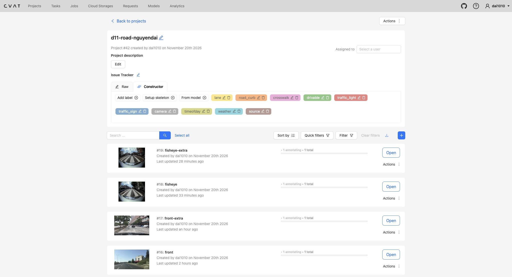
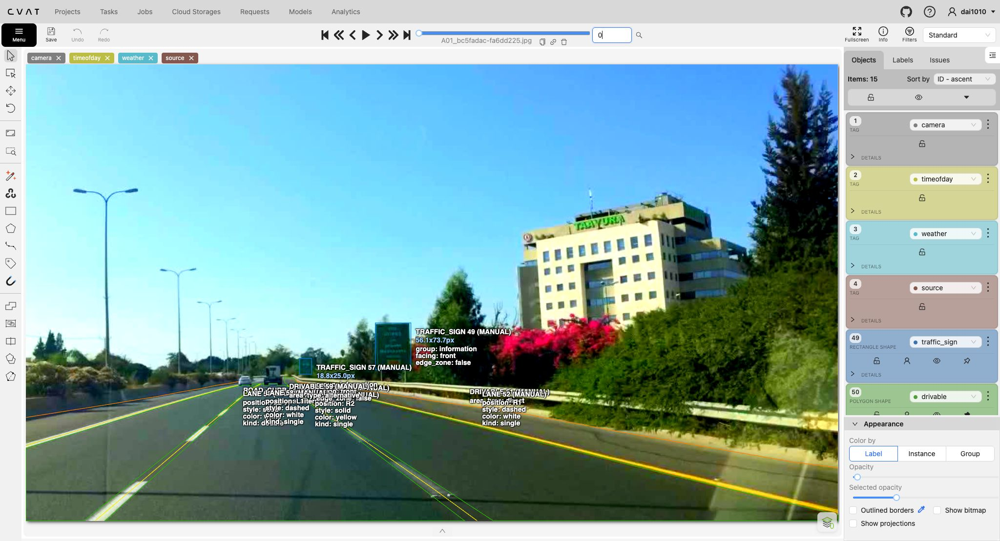
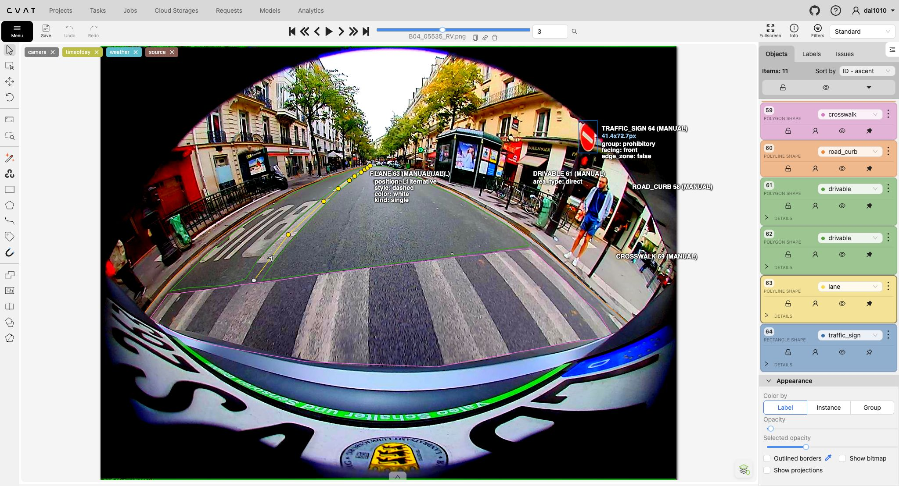
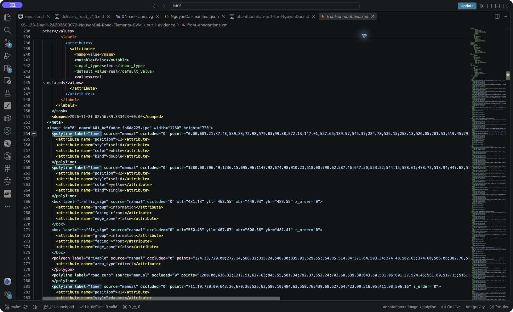

# Báo cáo cá nhân — Ngày 11
Họ tên: Nguyễn Đại    Mã học viên: 2A202603072 (theo tên thư mục bài làm)  
Phiên bản CVAT (Help → About): 2.83.1 (người dùng cung cấp)  
Guideline: Road v1.0    Lần nộp (`revision` trong manifest): 3 (bản sửa theo hướng dẫn coach)  
Mốc tạo manifest revision 3: xem `created_at` trong file JSON. Bản ZIP được sửa từ XML đã lưu; giờ export trên CVAT chưa xác minh. Số lần nộp lại sau Rework: 2  

## 1. Kiểm project
| Mục | Đúng như guideline Road v1.0? | Ghi chú |
| --- | --- | --- |
| 6 label, đúng kiểu | Đúng | Đã tạo project CVAT #42 từ cấu hình Road v1.0 và thấy đủ 6 label vẽ: `lane`, `road_curb` (polyline); `crosswalk`, `drivable` (polygon); `traffic_light`, `traffic_sign` (rectangle). |
| Thuộc tính và giá trị | Đúng theo Raw JSON đã nhập | `lane`: position/style/color/kind; `drivable`: area_type; đèn: color/type/facing/edge_zone; biển: group/facing/edge_zone. Giá trị chi tiết theo Road v1.0. |
| 4 tag ảnh | Đúng theo Raw JSON đã nhập | `camera`, `timeofday`, `weather`, `source`: mỗi tag có một thuộc tính select `value`; cả bốn hiện trong project. |
Cách kết thúc polyline theo hướng dẫn thao tác của lab: nhấn `N` sau điểm cuối; không có bản ghi thao tác để xác nhận phím đã dùng ở từng hình.  
Cách đặt tag ảnh: dùng công cụ Tag, đặt `camera` trước rồi kiểm thuộc tính `value` trong Details. XML bàn giao xác nhận 28/28 ảnh có đủ bốn tag.  

**Project đã tạo:** `d11-road-nguyendai` (CVAT #42). Bốn task, mỗi task một job: `front` (#16, A01–A12, 12 frame), `front-extra` (#17, A13–A16, 4 frame), `fisheye` (#18, B01–B08, 8 frame), `fisheye-extra` (#19, B09–B12, 4 frame). Đã xác nhận số frame trên trang từng task; ảnh tab Labels và job được lưu ở mục 6.

## 2. Số lượng đã gán
| Task | Ảnh có shape / tổng ảnh | lane | road_curb | crosswalk | drivable | traffic_light | traffic_sign | Tổng shape trong bản r3 |
| --- | ---: | ---: | ---: | ---: | ---: | ---: | ---: | ---: |
| front | 12 / 12 | 32 | 15 | 10 | 25 | 38 | 30 | 150 |
| front-extra | 4 / 4 | 12 | 8 | 8 | 9 | 11 | 15 | 63 |
| fisheye | 8 / 8 | 7 | 14 | 10 | 10 | 6 | 5 | 52 |
| fisheye-extra | 4 / 4 | 0 | 3 | 5 | 3 | 0 | 0 | 11 |

Nguồn đếm: `annotations.xml` trong hai ZIP revision 3. Tổng cộng **28 ảnh, 276 shape**, 28/28 ảnh đủ bốn tag. Từ r2 sang r3, A09 và A14 mỗi ảnh thêm một polyline cho nét thứ hai của vạch đôi bên trái theo hướng dẫn coach. Bản r1 và r2 được lưu lần lượt ở `out/archive/r1/` và `out/archive/r2/`. Chưa xác minh các sửa đổi XML đã được đồng bộ lên job CVAT.

## 3. Bảng ca khó
| Ảnh | Nhãn | Phân vân giữa | Đã chọn | Lý do |
| --- | --- | --- | --- | --- |
| A05 | `lane` / `road_curb` / `drivable` | Có nên suy ra L1/R1 từ mép đường và hàng xe đỗ khi không thấy vạch sơn? | Không vẽ `lane`; gán `drivable=direct` cho phần đường đi được; mép vỉa bên phải là `road_curb` trong bản gán CVAT. | Ảnh không có tâm vạch sơn đủ rõ để đặt polyline trong ngưỡng 5 px. Mép vỉa là ranh giới vật lý, không phải vạch sơn; dải xe đỗ không thuộc vùng `direct`. File CVAT mới đã giữ lại `road_curb` dạng polyline để kiểm hình này. |
| A11 | `traffic_light` | Đèn đang sáng hướng về xe hay mặt sau của cụm đèn? | Hai cụm đèn hướng về xe gán `green`, `type=vehicle`, `facing=front`; một mặt sau gán `color=unknown`, `facing=back`. | Chỉ lấy màu xanh từ bóng đang sáng nhìn thấy trên mặt đèn. Mặt sau không cho biết màu tín hiệu hướng về xe, nên không suy màu từ các đèn bên cạnh. |
| B03 | `drivable` | Vùng đường ngay sau xe và làn kế bên: `direct` hay `alternative`; có tính phần thân xe ở đáy ảnh không? | Tách hai polygon `direct` và `alternative`, dừng ở ranh giới đường nhìn thấy, không phủ phần thân xe. | Ảnh `fisheye_rear` thấy nhiều làn nhưng thân xe và viền tối ở đáy ảnh không phải mặt đường. `direct` là phần đường gắn với làn xe, `alternative` là phần cùng chiều bên cạnh. |
| B04 | `crosswalk` / `lane` / `drivable` | Các dải trắng ngang gần mép xe là vạch làn hay lối qua đường? | Một polygon `crosswalk` bao vùng vạch ngựa vằn; vùng `drivable` được vẽ riêng và không tràn lên thân xe. | Các dải trắng nằm ngang thành một cụm qua đường, không chạy dọc theo hướng làn. Ảnh fisheye làm đường cong mạnh ở rìa, nên bám mép nhìn thấy thay vì nối thẳng qua thân xe. |
| B05 | `crosswalk` / `road_curb` | Nhiều dải trắng cong ở camera trái là các lane riêng hay một vùng qua đường; mép bên kia là vạch sơn hay vỉa hè? | Một `crosswalk` polygon cho cả cụm; một `road_curb` polyline cho mép vỉa. | Các dải trắng song song thuộc cùng lối qua đường và bị phối cảnh fisheye uốn cong. Mép vỉa có ranh giới vật lý, không phải tâm vệt sơn làn; phần thân xe ở tiền cảnh bị loại khỏi hình. |
| A09 | `lane` vạch đôi | Một polyline `kind=double` hay hai đường theo từng nét sơn? | Hai polyline cùng `position=L2`, mỗi đường trên một nét; không vẽ R1 bên phải. | Coach hướng dẫn kẻ hai nét riêng; R1 bên phải không nhìn thấy. |
| A14 | `lane` vạch đôi | Vạch vàng đôi bên trái và R1 bên phải ảnh đêm | Hai polyline cùng `position=L1`, mỗi đường trên một nét; không vẽ R1 bên phải. | Bám hai nét vàng nhìn thấy; coach xác nhận bên phải không thấy R1. |
| A13 (ảnh thêm) | tag `weather` | Trời xám là `overcast` hay `rain`? | `weather=rain`. | Có giọt nước rõ trên kính và mặt đường ướt; theo guideline, dấu hiệu mưa/mặt đường ướt quyết định `rain` dù bầu trời cũng nhiều mây. |

**Đã sửa trong bản ZIP chuẩn bị nộp:** Export fisheye gốc có năm `lane.position=L1/R1` ở B06–B08, trái quy tắc camera hai bên. Bản `out/submission/NguyenDai-fisheye.zip` đã đổi năm thuộc tính này thành `other`; bản r1 đã được giữ trong `out/archive/r1/` để đối chiếu. Cần thực hiện cùng thay đổi trên job CVAT trước lần export tiếp theo.

**Hướng dẫn coach đã áp dụng ở r3:** Theo thông tin học viên ngày 21/11/2026, A09 và A14 cần vẽ hai nét của vạch đôi bên trái; bên phải hai ảnh không nhìn thấy R1. A09 có hai polyline cùng `position=L2`, A14 có hai polyline cùng `position=L1`, mỗi đường bám một nét sơn riêng và giữ `kind=double` để thể hiện cùng một vạch đôi. Hai cảnh báo QC1-05 do trùng `position` là hệ quả của cách biểu diễn này, không phải vạch đứt bị tách. Thiếu R1 ở A09/A14 được ghi là ngoại lệ QC1-02 theo xác nhận coach do học viên cung cấp.

## 4. Phiếu QC 1 nhận được
Người kiểm: **Phan Thanh Hào**. Phiếu mới ngày 21/11/2026 kiểm sáu ảnh bắt buộc **A01, A02, A03, A12, B01, B08** của revision 1: 59 shape + 24 tag = **83 nhãn**. Quyết định **Release trên mẫu**: 0 lỗi nặng, 2 lỗi chính (2/83 = 2,41%), 4 lỗi nhẹ, 0 ca chờ lead. A01 và B01 được ghi không lỗi. Phiếu gọi ZIP là `NguyenDai-front (1).zip` và `NguyenDai-fisheye (1).zip`; số shape mẫu khớp bản r1 đã lưu, nhưng không có SHA-256 để chứng minh cùng từng byte.

| Mã lỗi | Số lỗi trong mẫu | Đã xử lý trên ZIP revision 3? |
| --- | ---: | --- |
| QC1-05 | 1 chính | A12 hai polyline `lane.position=L1`: đã đổi đoạn biên ngoài bên trái thành `L2` sau khi đối chiếu ảnh. Lint không còn cảnh báo này. |
| QC1-11 | 1 chính | B08 lane chỉ ba điểm: đã thêm điểm trên cung vạch và đảo chiều điểm từ gần ra xa. Lint không còn cảnh báo này. |
| QC1-12 | 4 nhẹ | Đã xóa điểm lặp liền nhau ở A02 `lane#1`, A03 `drivable#2`, A03 `lane#4`, A12 `drivable#6`; lint không còn cảnh báo tương ứng. |

Hai box đèn dưới 8 px tại A03 được người kiểm loại khỏi lỗi bắt buộc. Bản r2 còn sửa năm `edge_zone` trên fisheye và một điểm lặp ở B04 theo kiểm tra toàn lô; r3 tách vạch đôi A09/A14 thành hai nét. Phiếu QC của Phan Thanh Hào **chỉ kết luận Release cho mẫu r1**; người kiểm chưa kiểm lại r3.

Theo thông tin học viên ngày 21/11/2026, coach đã xác nhận A05/A06 không thấy L1/R1 và A09/A14 không thấy R1 bên phải. Sáu cảnh báo QC1-02 của lint do đó có lý do miễn theo đặc tả; manifest vẫn ghi đủ sáu cảnh báo thô. Bản r3 phát sinh hai gợi ý QC1-05 vì mỗi vạch đôi được vẽ thành hai polyline cùng `position`, theo hướng dẫn coach. Chưa có biên bản xác nhận viết riêng từ coach và bốn job CVAT chưa ở trạng thái `completed`.

## 5. Kiểm file export
Đối chiếu bốn ZIP **CVAT for images 1.1** tải từ từng task ngày 21/11/2026 (bản lưu tại `out/archive/cvat-before-sync/`) với hai ZIP revision 3 trong thư mục nộp. Các bản export task chỉ chứa `annotations.xml`, không chứa ảnh.

| Task/job | Ảnh | Shape trong export task / ZIP nộp | Ảnh đối chiếu 1 (task / file) | Ảnh đối chiếu 2 (task / file) | Tag camera trong XML nộp |
| --- | ---: | ---: | --- | --- | --- |
| `front` #16 | 12 | **155 / 150** | A01: 11 / 11 | A02: 8 / 8 | `front` |
| `front-extra` #17 | 4 | **66 / 63** | A13: 8 / 8 | A14: 19 / 18 | `front` |
| `fisheye` #18 | 8 | **52 / 52** | B01: 5 / 5 | B02: 10 / 10 | `fisheye_front` |
| `fisheye-extra` #19 | 4 | **11 / 11** | B09: 4 / 4 | B10: 1 / 1 | `fisheye_front` / `fisheye_left` |

Shape trong export task và ZIP nộp **chưa khớp** ở front/front-extra. Riêng fisheye có cùng số shape nhưng năm `lane.position` tại B06–B08 trong export task vẫn là `L1/R1`, còn ZIP nộp đã sửa thành `other`; các thuộc tính và điểm vẽ khác cũng chưa được đồng bộ. Fisheye-extra khớp về hình và tag. Khi kiểm danh sách Jobs trên CVAT ngày 21/11/2026, cả bốn job #16–#19 đang ở trạng thái `in progress`, chưa đạt yêu cầu `completed`. Đây là giới hạn của bản nộp hiện tại; không coi shape count bằng nhau là chứng cứ hai bản giống hệt.

Hai ZIP nộp mở được bằng parser CVAT for images 1.1 và chỉ chứa `annotations.xml`: front **16 ảnh/213 shape**, fisheye **12 ảnh/63 shape**. Cả 28 ảnh đủ bốn tag. SHA-256/số byte của hai ZIP khớp manifest revision 3; `contains_images` đều là `false`.

Chạy `PYTHONPATH=src python3 -m road_lab.road_check lint` trên **hai ZIP nộp** cho kết quả **6 nặng, 2 chính, 8 nhẹ**, khớp manifest. Sáu cảnh báo QC1-02 là A05 thiếu L1/R1, A06 thiếu L1/R1, A09 thiếu R1, A14 thiếu R1; theo xác nhận coach do học viên cung cấp, các vạch này không nhìn thấy nên được ghi là ngoại lệ, trong khi lint vẫn đếm cảnh báo thô. Hai cảnh báo QC1-05 tại A09/A14 phát sinh vì vạch đôi bên trái được thể hiện bằng hai polyline cùng `position` theo hướng dẫn coach. Phiếu QC của Phan Thanh Hào kết luận Release trên mẫu revision 1; revision 3 chưa được người kiểm kiểm lại.

## 6. Ảnh chụp màn hình
1. Tab Labels của project #42: 
2. Ảnh A01, job front #16: 
3. Ảnh B04, job fisheye #18, chọn polyline lane cong: 
4. Ảnh chụp trích đoạn XML có cú pháp CVAT, có `<polyline label="lane">`: . XML đầy đủ nằm trong ZIP front đi kèm. Ảnh thứ tư chụp `front-annotations.xml` trong VS Code; XML của bản nộp nằm trong ZIP hiện tại.

## 7. Tự đánh giá
**Lỗi xác nhận lặp lại nhiều nhất:** QC1-03, năm polyline `lane` tại B06–B08 có `position=L1/R1` dù ảnh thuộc camera fisheye trái/phải; đúng là `other`. Tôi đã sửa năm thuộc tính trong ZIP fisheye gộp. Ở lần tiếp theo sẽ kiểm `camera` trước khi chọn `position`, lọc tất cả ảnh fisheye bên trái/phải sau export và chạy lint lại. Sửa trên CVAT trước khi export lại để job và file khớp nhau.

**Nhãn đi vào model:** Polyline và thuộc tính là nhãn đích để huấn luyện model phát hiện và phân loại làn. Nếu giữ `L1/R1` sai trên ảnh camera bên, model nhận ví dụ sai rằng vạch nhìn lệch và cong do fisheye là làn trái/phải của hướng đi trước xe. Khi suy luận, nó có thể gán sai vị trí làn và cung cấp thông tin sai cho bài toán giữ làn. Năm lỗi này đã sửa trong file gộp; chưa xác minh trạng thái tương ứng trên CVAT.
